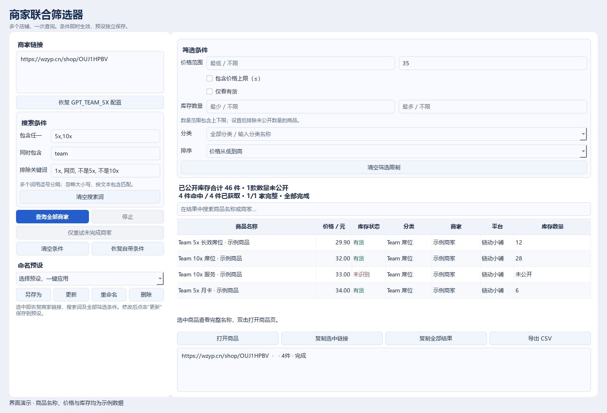
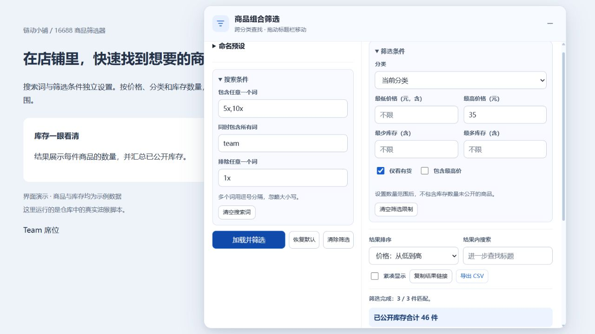
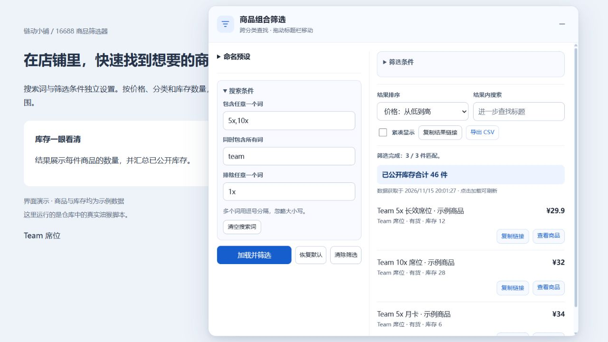

# 链动小铺 / 16688 商品筛选器

想找某个价位、指定规格且有货的商品？填写条件，就能把符合要求的商品集中列出来，按价格比较，还能保存常用筛选条件。

## 先选一个版本

| 你想怎么用 | 选择 |
| --- | --- |
| 同时比较多个商家的商品 | **Windows 软件**：下载、解压、双击运行 |
| 在浏览器里筛选正在看的店铺 | **油猴脚本**：需要先安装 Tampermonkey 扩展 |

**[下载 Windows 软件](https://github.com/drdon1234/ldxp_16688_radar/releases/latest/download/merchant-radar-windows.zip)** · **[下载油猴脚本](https://github.com/drdon1234/ldxp_16688_radar/releases/latest/download/shop-filter.user.js)** · [所有版本](https://github.com/drdon1234/ldxp_16688_radar/releases)

## Windows 软件：三步开始

1. 解压下载的压缩包，双击 **商家联合筛选器.exe**，不用安装其他软件。
2. 粘贴商家主页链接，**每行一个**。链动小铺和 16688 可以放在一起，也可以选择自带预设 **GPT_TEAM_5X**，其中包含原有的 53 家商家。
3. 左侧搜索条件用于固定本次查询的商品集合；填写后点击 **查询全部商家**。右侧筛选条件拥有独立的关键词、分类、价格和库存逻辑，修改右侧条件会立即筛选已获取结果，不会重复请求接口。结果默认从便宜到贵排列，双击商品即可打开购买页面。

*截图使用示例商品，演示布局和库存显示。*

查询过程中就可以查看已找到的商品，无需等所有商家查完。想换条件时直接修改即可；想看某一类商品，选择分类；想看所有分类，清空分类框。

> 填店铺主页链接，不是单个商品链接。例如：`https://wzyp.cn/shop/OUJ1HPBV`。

## 筛选条件怎么填？

例如，你想找：**5x 或 10x 的 Team 商品，不要 1x，低于 35 元，而且有货。**

| 界面上的选项 | 填写内容 |
| --- | --- |
| 包含任一 | `5x,10x` |
| 同时包含 | `team` |
| 排除关键词 | `1x` |
| 最低价 | 留空 |
| 最高价 | `35`，不勾选“包含价格上限” |
| 仅看有货 | 勾选 |

自带的 **GPT_TEAM_5X** 预设采用这组条件，还排除了 `网页、不是5x、不是10x`，你可以直接修改。多个关键词用逗号隔开，大小写都可以。

- 想把 **35 元整**也算进去：勾选“包含价格上限”。
- 不想限制某项：清空对应输入框；想重新开始，点击“清空条件”（脚本中为“清除筛选”）。
- 不想看到“网页”商品：排除关键词改为 `1x,网页`。
- 结果里出现“不是5x”：筛选只看标题是否含有这些文字，可以把 `不是5x` 也加入排除词。

库存数量可以填写最少和最多值，两个边界都包含在内；留空表示不限。上方的“已公开库存合计”只汇总当前命中商品的已公开数量。数量未公开会单独标注，设置库存数量范围后不会纳入结果。

## 常用条件只需保存一次

调好条件后，在“命名预设”中点击 **另存为**，起个容易记的名字。以后选中这个名字，就能恢复整套条件，也可以更新、改名或删除。

桌面版预设会一起保存 **商家链接、搜索词、分类、价格、库存和排序**，选中即可恢复整套配置。改好后点击“更新”，也可以“另存为”一份新配置。发布版只自带 **GPT_TEAM_5X** 一个预设。

油猴脚本用于当前店铺，预设保存条件，可在不同店铺使用。两种版本的预设各自保存，不会互相同步。

找到合适的商品后，可以复制链接发给别人，也可以导出 CSV，用 Excel 打开查看。

## 油猴脚本怎么用？

1. 在浏览器中安装 **Tampermonkey（油猴）** 扩展，再下载上方的脚本文件。
2. 打开 Tampermonkey 管理面板，新建脚本，用下载文件的全部内容替换编辑器中的内容，保存。
3. 打开或刷新链动小铺、16688 商家页面，在右上角悬浮窗中选择分类、填写条件，点击 **加载并筛选**。

*截图为真实脚本在示例页面中的运行效果，商品与库存为演示数据。左侧搜索，右侧筛选；收起右侧条件后可查看更多结果。*

悬浮窗可以拖动、收起。脚本只筛选当前店铺；需要同时比较多个商家时，用 Windows 软件。

## 遇到问题

**查询慢，或者提示暂停、冷却？**

商家较多时需要等待，软件会主动放慢查询。提示访问受限时，请按提示稍后再试，不要连续点击查询或反复重启。桌面版可以用“仅重试未完成商家”补查失败的店铺。

**显示“部分数据”，还能用吗？**

可以查看已有结果，但可能漏掉尚未查到的商品。看到“0 件”也不一定代表商家没有商品，先看该商家的查询状态。

**怎样更新？会丢预设吗？**

桌面版先关闭旧程序，再用新 EXE 替换，原有设置和预设会保留。油猴版更新时替换原脚本，不要重复安装。

**怎样备份桌面版设置？**

关闭软件，按 `Win + R`，输入 `%LOCALAPPDATA%\MerchantFilter`，复制里面的 `settings.json` 即可。它保存了商家链接、筛选条件和预设。

价格和库存会变化，最终以商品页面为准。软件自带商家列表仅为查询入口，不代表对商家信誉的推荐。
